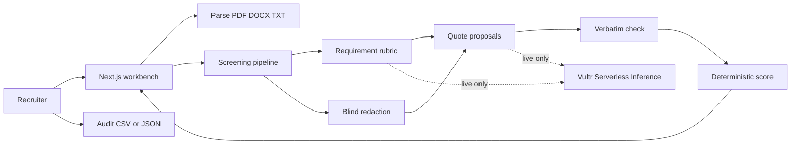

# CiteScreen

Evidence-based resume pre-screening for recruiters. Built for the lablab.ai Vultr **Agent Rush** hackathon, track **Powering the Future of Work** (HR & Recruitment). Submission deadline: 2026-11-08 22:00 UTC.

CiteScreen reads a job description and up to eight resumes. It turns the job into an explicit rubric, then scores each requirement only from **verbatim lines** in the resume. If a resume never says it, the status is **no evidence** and the score is 0. A recruiter confirms or overrides every recommendation. The same rubric is run again on a redacted copy so a shift that depends on a name, a school, an age, a photo reference, or a gender cue is visible.

The six resumes and two job descriptions in `data/` are synthetic. They are not real people.

## Run it locally, with no API key

```bash
npm install
npm test
npm run dev
```

Open [http://127.0.0.1:43123](http://127.0.0.1:43123). The header should say **Deterministic mock · no API key**. Load the payments packet, check the rubric, then **Score on evidence**.

Mock mode does not call a model. Requirement extraction for the two sample jobs uses the curated rubric in `src/lib/screening/rubrics.ts`. Any other job text is split on bullets under Requirements, Preferred, and Responsibilities. Evidence search, citation checks, scores, ranking, redaction, and the fairness delta are the same functions the tests cover.

## Live mode on Vultr Serverless Inference

The client is the official `openai` package pointed at Vultr's OpenAI-compatible API.

| Setting | Value |
| --- | --- |
| Base URL | `https://api.vultrinference.com/v1` |
| Key | `VULTR_API_KEY` (also accepts `VULTR_INFERENCE_API_KEY`) |
| Default model | `deepseek-v4.1-flash-1017` |

That model id was checked against the public catalog on 2026-11-02: [Models and pricing](https://api.vultrinference.com/docs/models). It is also the documented default when a chat request omits `model`. Other verified chat ids you can put in `VULTR_MODEL` or the on-screen model field:

`glm-5.2`, `glm-5.3`, `glm-5.3-flash`, `mimo-v2.6-flash`, `mimo-v2.6-pro`, `minimax-m3.1-flash`, `muse-glimmer-30b`, `nemotron-3-nano-omni-30b-a3b-reasoning`, `nemotron-3.5-content-safety`, `qwen3.8-27b`, `qwen3.8-flash-next`, `raon-1-mini-preview`.

```bash
cp .env.example .env
# edit .env and set VULTR_API_KEY
npm run dev
```

Live mode still does not trust the model with the score. The model may only propose requirement text and quotes. A quote that is not a verbatim substring is discarded, and the deterministic scorer assigns the number. The browser cannot submit a key. Do not commit `.env`.

`SCREENING_MODE=mock` forces the mock even if a key is present. `SCREENING_MODE=live` errors when the key is missing. `auto` (the default) uses live only when a key is set.

## Architecture



In mock mode the quote step is a local line search, not a model call. In live mode Vultr proposes quotes and the server throws away anything it cannot find in the resume.

## How a point is earned

- Must-haves weigh 3, responsibilities 2, nice-to-haves 1. The overall score is the weighted average, 0–100.
- **Supported** means enough of the requirement's keywords appear inside the cited lines, and an explicit year count meets an `N+ years` bar when the job states one.
- **Partial** means some of the wording is there, the year count is too low or missing, or the only hit is a weak signal such as the word "university" with no degree type.
- **No evidence** means nothing citable. The contribution is 0. The system does not guess from a job title, a date range, or a school name.
- `2016 - 2024` is not treated as eight years. Only a stated count, such as "8 years", counts. "54-year-old" does not count either.
- Two missing must-haves is a decline. One missing must-have is a hold only when the rest of the evidence is still reasonably strong. A clean must-have slate at 80 or above is an advance.
- Recommendations are labels for the recruiter. They do not move a candidate forward until a person confirms or overrides them. An override requires a note. Every action is appended to the audit log and can be exported as CSV or JSON.

## Blind review

Redaction removes, best-effort and visibly:

- the candidate's name
- gendered pronouns, titles, and words such as "women" or "father of three"
- photo references and markdown images
- university, college, institute, bootcamp, and a short list of school abbreviations
- ages, "born in" years, and "class of" years
- email addresses, phone numbers, and profile URLs

Employment ranges such as `2019 - 2024` stay. Skill words that shared a sentence with a pronoun stay. The scorer runs again on that text. A candidate is flagged when the overall score moves by at least 8 points (configurable with `FAIRNESS_SHIFT_THRESHOLD`) or when a requirement loses every citation.

In the sample payments packet, Robert Okonkwo's age, family wording, headshot, and Georgia Tech line come out, and his score stays put because the citations are the work. Helen Cho's degree credit comes only from "Stanford University". After redaction that requirement becomes no evidence and she is flagged. That is the point of the check: a citation that was really a school name should not survive a blind read.

## What's in the box

| Path | Contents |
| --- | --- |
| `data/jobs/` | Senior backend engineer at Northwind Ledger, people operations partner at Harbor & Pine |
| `data/resumes/` | Six synthetic resumes |
| `src/lib/screening/` | Rubric, evidence, score, redaction, audit, Vultr client |
| `src/app/api/` | Health, samples, requirements, screen, file parse |

Upload limits: PDF, DOCX, or TXT, 8 MB, text extracted in memory and not written to disk. A scanned PDF with no text layer returns an error asking you to paste.

## Tests

```bash
npm test
```

Node's test runner, via `tsx`. Covers no-evidence versus supported, rejection of fabricated quotes, year-count rules, ranking, redaction that preserves Kubernetes and Heroku while removing names and schools, the sample shortlist, the fairness flag, and CSV/JSON audit escaping.

## Two-minute demo

0:00 Open the app. Point at **Deterministic mock · no API key**. Load the Northwind payments packet.

0:15 The requirements are already listed, including the bachelor's degree line. Say that nothing is scored until this rubric is visible.

0:25 Click **Score on evidence**. Amina Shah and Robert Okonkwo advance. Marcus Hale is a hold: logistics backend, no payments evidence. Helen Cho, Diego Alvarez, and Priya Raman do not advance.

0:45 Open Helen. Kubernetes and payments say **No evidence**. The degree row is only partial, and the quote is just "Stanford University". Do not let a model "fill in" a backend career.

1:05 Open Amina. Click production Kubernetes and show the highlighted sentence, including the pronoun that is not what the point is based on.

1:20 Confirm Amina's advance. Open Helen again, choose **Hold**, and write a note such as "Portfolio review, not a backend advance." The audit tab shows an override.

1:35 Open **Blind review**. Robert's delta is under the 8-point bar even though age, "father of three", the headshot, and Georgia Tech were removed. Helen is flagged because the degree citation disappeared with the school name.

1:50 Export the audit JSON. Close on the line: if it is not written down, it is not a point.

Switching to the Harbor & Pine packet is the backup beat: only Priya Raman advances, and the engineers do not inherit people-ops credit they never wrote down.

## Pitch outline

1. **Problem.** Resume screening is where hiring quality and bias enter the funnel. A fluent model will happily invent a fit. A tired recruiter will overweight a school or a young-sounding summary. Neither leaves a record.
2. **Product.** CiteScreen is a pre-screening desk, not an autopilot. Every point is a quote or an explicit gap. The recruiter confirms or overrides, and the override is the audit.
3. **Proof in the demo.** The Stanford resume does not rise. The 54-year-old staff engineer does not fall when age and school are removed. A degree claim that was only a school name is flagged.
4. **Why Vultr.** Serverless Inference is OpenAI-compatible, so the quote-proposal step swaps models with an environment variable. `deepseek-v4.1-flash-1017` is the default. Judges can run the whole product with no key.
5. **Trust boundary.** The model never owns the number. Unverified quotes score as no evidence. Protected attributes are not positive features. The human decision is what moves someone forward.
6. **Ask.** Pilot with one recruiting pod for two weeks. Success is an audit log a hiring manager can read, not a hidden rank.

## Deploy on a Vultr VM

A small Ubuntu VM is enough. Docker is the path that matches this repo.

```bash
sudo apt-get update && sudo apt-get install -y docker.io
sudo docker build -t citescreen .
sudo docker run -d --name citescreen -p 80:43123 --env-file .env citescreen
```

Omit `--env-file` to boot in mock mode. The container listens on `43123` inside and can be published on port 80. `HOSTNAME=0.0.0.0` is set in the image.

Without Docker, on the VM:

```bash
npm ci
npm test
npm run build
PORT=43123 HOSTNAME=0.0.0.0 npm start
```

Production serves `node .next/standalone/server.js` after `npm run build`. The Docker image copies `public`, `.next/static`, and `data/` next to that server. Sample jobs are loaded from `data/` at request time.

Do not bake `VULTR_API_KEY` into the image. Pass it at runtime.

## 中文说明

CiteScreen 是给招聘人员用的循证简历预筛工具，参加 lablab.ai Vultr Agent Rush，赛道是「Powering the Future of Work」（人力资源与招聘）。它不替人做最终决定。

它做三件事：

1. 从职位描述抽出要求，再在每份简历里找**逐字引用**。简历里没写的，记为「没有证据」，分数为 0，不会靠学校、年龄或头衔去猜。
2. 招聘人员必须确认或改判每一条建议。改判要写备注。全部动作可导出 CSV 或 JSON，作为审计记录。
3. 把姓名、性别线索、照片提及、学校、年龄和联系方式抹掉后，用同一套规则再评一次。总分变化达到 8 分，或某条要求的证据被完全抹掉，就打上公平性标记。

本地无需密钥：

```bash
npm install
npm test
npm run dev
```

浏览器打开 http://127.0.0.1:43123 ，加载 Northwind 支付平台样例，先看要求列表，再点 Score on evidence。页头会标明当前是确定性 mock，没有调用模型。

接上 Vultr 推理时，在环境变量里设置 `VULTR_API_KEY`，可选 `VULTR_MODEL`（默认 `deepseek-v4.1-flash-1017`，已对照 2026-11-02 的公开模型目录）。接口基址是 `https://api.vultrinference.com/v1`，使用 OpenAI 兼容客户端。模型只负责提出引用，服务器会核对原句，对不上就丢弃。密钥只放在服务器，不要提交到仓库。

样例数据在 `data/jobs` 与 `data/resumes`：两份虚构职位、六份虚构简历。演示时可以强调：斯坦福背景的前端候选人不会因为校名被抬上去；54 岁的后端负责人在抹掉年龄和学校后分数基本不动；只靠校名撑起来的学历条目会被标记。

两分钟演示按上面的英文脚本走即可。部署可以用仓库里的 Dockerfile，在 Vultr 云主机上 `docker build` 后把容器的 43123 端口映射出去。不提供密钥时，容器以 mock 模式启动，评委可以直接试用。

架构就是：浏览器工作台 → 解析 PDF/DOCX/TXT → 抽要求 → 找原句并核验 → 确定性打分与排序 → 脱敏后再打分 → 人工确认写入审计日志。只有开启 live 模式时，抽要求和找原句才会请求 Vultr Serverless Inference。
